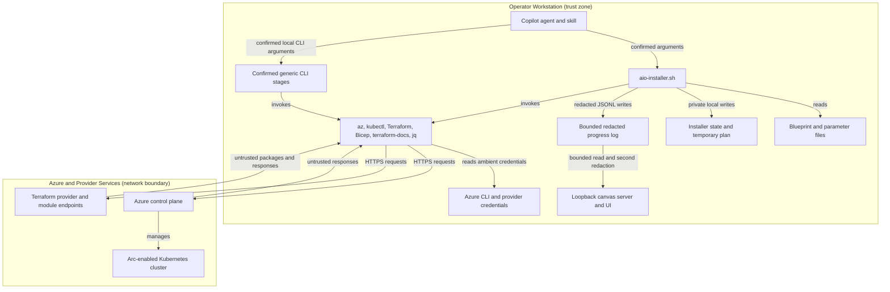

<!-- markdownlint-disable-file -->
<!-- cspell:ignore accDescr -->
# AIO Installer Skill Security Model

The AIO Installer skill ships `scripts/aio-installer.sh` for repository blueprints and generic local Azure CLI commands. The workspace extension reads its state and bounded redacted progress log through a loopback-only canvas server. These flows read deployment inputs, invoke local infrastructure tools, and send deployment requests to Azure. The model separates local workspace, progress display, and tool execution from Azure control-plane and cluster execution. Each bucket enumerates all six STRIDE categories with the controls that address them.

> **Repository-wide STRIDE model:** This repository does not currently include `docs/security/security-model.md` or its Skill Security Models registry. This per-skill model remains the available threat-model record until a repository-wide registry is added.

## Executive Summary

The script confines blueprint inputs to the repository, writes installer state, progress, and temporary plans with private permissions, fingerprints reviewed deployment inputs, and requires explicit apply confirmation. The canvas reads progress through a cookie-protected loopback server and applies a second redaction pass before display. Its highest-risk behavior is invoking Azure CLI and Terraform with the operator's ambient credentials. Residual risks remain around best-effort output redaction, local toolchain integrity, sensitive Terraform state, and long-running external commands.

### Security Posture Overview

| Dimension          | Value                                                                                                      |
|--------------------|------------------------------------------------------------------------------------------------------------|
| Runtime surface    | Agent-guided Azure CLI and kubectl; Bash, Terraform, Bicep, terraform-docs, jq, and loopback canvas server |
| Trust buckets      | Two: local workspace and toolchain; Azure control plane and providers                                      |
| Credentials        | Ambient Azure CLI and Terraform provider credentials                                                       |
| Network egress     | Azure management endpoints and Terraform provider or module endpoints                                      |
| Open residual gaps | Four (highest severity: InfoDisc-High)                                                                     |

## Contents

* [System Description](#system-description)
* [Trust Boundaries](#trust-boundaries)
* [Assets](#assets)
* [Adversaries](#adversaries)
* [Bucket B1: Local Workspace and Toolchain](#bucket-b1-local-workspace-and-toolchain)
* [Bucket B2: Azure and Provider Execution](#bucket-b2-azure-and-provider-execution)
* [Enterprise Readiness Gaps](#enterprise-readiness-gaps)
* [References](#references)

## System Description

### Components

1. `SKILL.md` defines deployment selection, confirmation, and secret-handling requirements.
2. The AIO Installer agent asks for the deployment path and guides confirmed generic Azure CLI and `kubectl` stages.
3. `scripts/aio-installer.sh` discovers blueprints, persists state, validates inputs, creates deployment previews, applies reviewed changes, and verifies results.
4. `server.mjs` reads state and progress, validates and redacts events, and serves the canvas on loopback.
5. `app.mjs` renders structured state and sanitized progress with text-only DOM operations.
6. Azure CLI, kubectl, Terraform, Bicep, terraform-docs, and jq provide external command execution.
7. Repository blueprint files and user-selected parameter or dependency values provide deployment inputs.
8. Azure control-plane APIs, Terraform providers, and the Arc-enabled cluster create and query resources.

### Data Flow



## Trust Boundaries

### Boundary Diagram

```text
+--------------------------------------------------------------+
| TRUST BOUNDARY: Operator Workstation                         |
| Agent +--> aio-installer.sh --> repository inputs            |
|       |        +-- private state and temporary plan           |
|       |        +-- az / Terraform / Bicep / jq                |
|       +--> confirmed generic az / kubectl stages              |
|                         | ambient credentials                 |
+-------------------------+------------------------------------+
                          | HTTPS
+-------------------------v------------------------------------+
| TRUST BOUNDARY: Azure and Provider Services                  |
| Azure control plane, Terraform providers, Arc-enabled cluster|
+--------------------------------------------------------------+
```

### Boundary Descriptions

| Boundary                    | Assets Protected                                 | Controls Enforced                                                                                     |
|-----------------------------|--------------------------------------------------|-------------------------------------------------------------------------------------------------------|
| Operator workstation        | Parameters, plan, state, credentials, repository | Repository path confinement, private permissions, fingerprints, quoting, staged user confirmation     |
| Loopback canvas             | Sanitized state and command progress             | Random cookie, origin and host checks, CSP, bounded reads, second redaction pass, text-only rendering |
| Azure and provider services | Subscription resources and cluster deployment    | Explicit subscription, preview before apply, confirmation, verification                               |

## Assets

| Id | Asset                           | Lifetime                | Notes                                                                     |
|----|---------------------------------|-------------------------|---------------------------------------------------------------------------|
| A1 | Azure identity and subscription | External session        | Managed by Azure CLI and Terraform, not stored in state                   |
| A2 | Blueprint and parameter inputs  | Repository lifetime     | Can influence cloud mutations                                             |
| A3 | Terraform plan and state        | Temporary or persistent | May contain sensitive deployment values                                   |
| A4 | Installer state                 | Deployment session      | Stores non-secret paths, runtime choice, fingerprints, and stage metadata |
| A5 | Sanitized progress log          | Deployment session      | Stores bounded redacted command lifecycle and output events               |
| A6 | Azure and Arc cluster resources | Deployment lifetime     | Externally visible and potentially costly                                 |

## Adversaries

| Id    | Adversary                               | In-scope mitigations                                               |
|-------|-----------------------------------------|--------------------------------------------------------------------|
| ADV-a | Malicious or compromised workspace      | Path confinement, file-name validation, input review, fingerprints |
| ADV-b | Local user without deployment authority | Private state and plan permissions                                 |
| ADV-c | Compromised PATH-resolved executable    | Operator-managed tool installation and command visibility          |
| ADV-d | Malicious or unexpected remote output   | Native command failures, staged execution, explicit verification   |
| ADV-e | Local process probing the canvas        | Loopback binding, random cookie, host and origin checks, CSP       |

## Bucket B1: Local Workspace and Toolchain

### Spoofing

* The script resolves its repository root from its own location and accepts blueprint names matching a restricted pattern.
* Parameter templates must be file names in the selected blueprint directory.

### Tampering

* Parameter and Bicep template fingerprints prevent apply after reviewed inputs change.
* Terraform applies the saved binary plan rather than recreating the plan during apply.
* Atomic state writes prevent partially written JSON from appearing as a valid state transition.

### Repudiation

* Installer state records the selected framework, subscription identity, successful stage, timestamps, fingerprints, and failures.
* The state is local evidence and is not an immutable audit log.

### Information Disclosure

* State and temporary plan files use owner-only permissions.
* The skill prohibits secret values in chat, state, command arguments, and committed parameter files.
* Progress output is redacted before storage, capped per command, privately written, bounded when read, and redacted again before display.
* Event labels and messages are redacted before persistence, including quoted multi-word secret values.
* Canvas output uses `textContent` and does not interpret command output as HTML.
* Terraform state is managed by the selected blueprint and is outside the installer's private temporary-plan control.

### Denial of Service

* Strict Bash error handling and staged recovery stop on command failure.
* Progress output is capped per command, trimmed to recent entries, and bounded again by byte and event count in the canvas server.
* External commands do not have installer-enforced timeouts or retries.

### Elevation of Privilege

* The script does not invoke `sudo` or modify Azure role assignments directly.
* PATH-resolved tools run with the operator's local and Azure permissions.

### Risk Rating

| Threat                               | Likelihood | Impact | Residual Risk | Status              |
|--------------------------------------|------------|--------|---------------|---------------------|
| Workspace input tampering            | Medium     | High   | Medium        | Partially Mitigated |
| Sensitive Terraform state disclosure | Medium     | High   | High          | Partially Mitigated |
| Sensitive command output disclosure  | Low        | High   | Medium        | Partially Mitigated |
| Compromised PATH-resolved executable | Low        | High   | Medium        | Accepted            |
| Long-running command exhaustion      | Medium     | Medium | Medium        | Accepted            |

## Bucket B2: Azure and Provider Execution

### Spoofing

* Authentication records the Azure tenant and subscription returned by Azure CLI.
* Terraform exports the recorded subscription, and Bicep deployment commands pass it explicitly.
* The generic wrapper enforces ordered stage predecessors, authentication before prerequisite commands, explicit continuation or completion intent, and exact confirmation tokens for dependency creation, initialization, and instance creation.
* Generic selection persists `stable` or `preview`; preview requires explicit terms acceptance, `--use-preview` on create, and installed-extension support.

### Tampering

* Terraform plan and Bicep what-if occur before apply or create.
* Apply checks parameter and template fingerprints before cloud mutation.
* The generic local flow displays each dependency, initialization, and instance-creation command before confirmation and passes the required mutation token to the wrapper.
* The wrapper rejects `--use-preview` for a stable selection and requires it for a preview selection.
* Remote Azure state can change after a Bicep what-if because what-if is not a saved executable plan.

### Repudiation

* Azure deployment records and Terraform state provide external operation records.
* The script preserves the failed or successful local stage for recovery.
* The generic local flow relies on conversation history and native Azure records rather than installer state.

### Information Disclosure

* Azure CLI and Terraform own credential storage and transport.
* Native command output can contain deployment metadata. The skill prohibits commands with secret values from using the wrapper, and the script and canvas server apply separate redaction passes.
* Raw output remains local to the terminal and is not served by the canvas.

### Denial of Service

* Provider downloads, Azure deployment operations, and cluster operations can fail or remain pending.
* The script stops the stage on failure and requires diagnosis before recovery.

### Elevation of Privilege

* Cloud operations execute with the permissions of the authenticated identity.
* Explicit confirmation does not replace Azure RBAC or least-privilege assignment.

### Risk Rating

| Threat                               | Likelihood | Impact | Residual Risk | Status              |
|--------------------------------------|------------|--------|---------------|---------------------|
| Wrong subscription or cluster target | Low        | High   | Low           | Mitigated           |
| Remote change after Bicep what-if    | Medium     | High   | Medium        | Partially Mitigated |
| Excessive Azure identity permissions | Medium     | High   | Medium        | Accepted            |
| Remote service or provider failure   | Medium     | Medium | Medium        | Partially Mitigated |

## Enterprise Readiness Gaps

The following limitations help operators decide whether additional controls are required. Severity ratings are project assessments and are not CVSS scores.

| Id      | Gap                                                                                                                 | Severity        | Status                                                                                                     |
|---------|---------------------------------------------------------------------------------------------------------------------|-----------------|------------------------------------------------------------------------------------------------------------|
| G-INF-1 | Blueprint-managed Terraform state can contain sensitive values without enforced remote encryption or access policy. | InfoDisc-High   | Configure a secured remote backend for team or production use                                              |
| G-INF-2 | Pattern-based progress redaction cannot guarantee removal of every sensitive value from arbitrary tool output.      | InfoDisc-Med    | Keep secrets out of wrapped commands and disable canvas progress when output sensitivity cannot be bounded |
| G-SUP-1 | PATH-resolved infrastructure tools and downloaded providers are not pinned or verified by this script.              | SupplyChain-Med | Use the repository dev container or an organization-managed toolchain                                      |
| G-DOS-1 | Long-running external commands have no installer-enforced timeout or retry policy.                                  | DoS-Med         | Monitor native progress and resume only after diagnosing the exact failure                                 |

## References

* [STRIDE threat modeling](https://learn.microsoft.com/azure/security/develop/threat-modeling-tool-threats)
* [Sign in with Azure CLI](https://learn.microsoft.com/cli/azure/authenticate-azure-cli-interactively)
* [Manage sensitive data in Terraform](https://developer.hashicorp.com/terraform/language/manage-sensitive-data)
* [Create Bicep parameter files](https://learn.microsoft.com/azure/azure-resource-manager/bicep/parameter-files)
* [Deploy Azure IoT Operations by using Azure CLI](https://learn.microsoft.com/azure/iot-operations/deploy-iot-ops/howto-deploy-iot-operations-cli)
